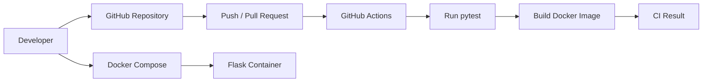

# Dockerized Flask App with GitHub Actions CI

A small Python Flask application packaged with Docker and tested automatically using GitHub Actions on every push and pull request.

This project demonstrates a simple CI workflow:

1. Check out the source code.
2. Set up Python.
3. Install dependencies.
4. Run automated tests.
5. Build the Docker image.

The workflow does not deploy to AWS or publish an image by default. This keeps the repository safe to fork and run without cloud credentials.

## Architecture



## Repository structure

```text
docker-cicd-demo/
├── app/
│   └── app.py
├── tests/
│   └── test_app.py
├── .github/
│   └── workflows/
│       └── ci.yml
├── Dockerfile
├── compose.yaml
├── requirements.txt
├── .dockerignore
└── README.md
```

## Run locally without Docker

```bash
python -m venv .venv
source .venv/bin/activate        # Windows: .venv\Scripts\activate
pip install -r requirements.txt
python -m flask --app app.app run --host=0.0.0.0 --port=5000
```

Open `http://localhost:5000`.

## Run with Docker Compose

```bash
docker compose up --build -d
docker compose ps
```

Open `http://localhost:5000`.

View logs:

```bash
docker compose logs -f
```

Stop the application:

```bash
docker compose down
```

## Run tests

```bash
pip install -r requirements.txt
pytest -v
```

## CI pipeline

The GitHub Actions workflow in `.github/workflows/ci.yml` runs on pushes and pull requests to `main`:

- Installs Python dependencies
- Runs `pytest`
- Builds the Docker image

To use it, push this project to a GitHub repository and check the **Actions** tab.

## Screenshots to add

After running the project, add screenshots to a `screenshots/` directory:

- `screenshots/app-homepage.png`
- `screenshots/docker-compose-ps.png`
- `screenshots/github-actions-success.png`

Do not add secrets, tokens, or personal environment details to screenshots.

## Learning outcomes

- Writing a Dockerfile
- Building and running a container
- Using Docker Compose
- Exposing an application port
- Adding a health check
- Writing basic automated tests
- Automating tests and image builds with GitHub Actions

## Next improvements

- Add image publishing to GitHub Container Registry (GHCR).
- Add a deployment stage to a dedicated test EC2 instance.
- Store deployment credentials in GitHub Actions Secrets.
- Add application logging and monitoring.

Only add deployment credentials as encrypted GitHub repository secrets. Never hardcode keys or passwords in workflow files.
